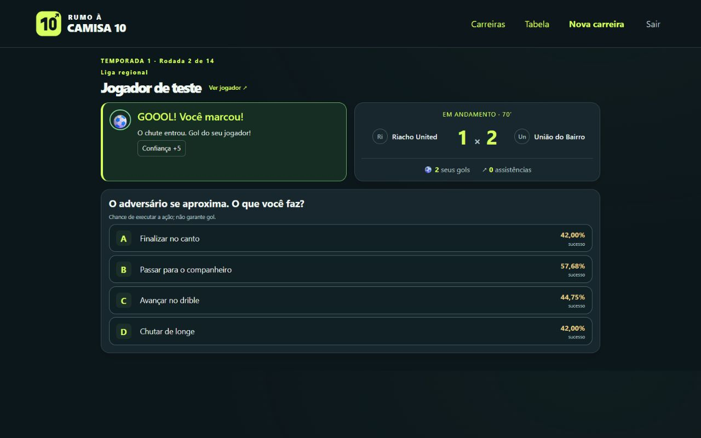
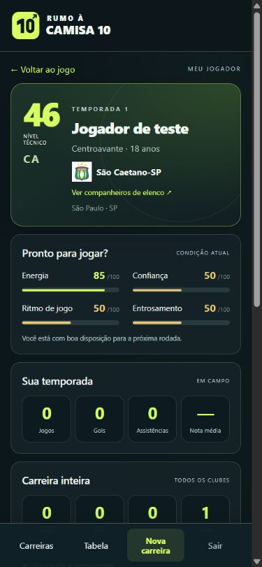
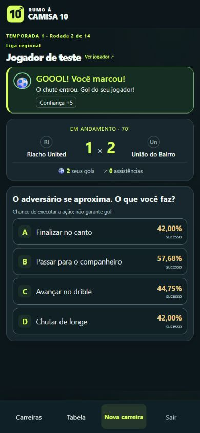

# Identidade visual e verificação — 14/10/2026

Logo próprio: numeral 10 geométrico e seta de evolução, verde-lima sobre fundo escuro. A identidade foi aplicada no cabeçalho do jogo e no cartão do Rumo10 no RumoHub.

## Arquivos

- `public/assets/brand/logo.svg` e `logo.png`: nome claro para fundos escuros.
- `public/assets/brand/logo-dark.svg` e `logo-dark.png`: nome escuro para fundos claros.
- `public/assets/brand/mark.svg`: símbolo isolado.
- `public/favicon.svg`, `public/favicon.ico` e `public/assets/brand/favicon-32.png`: favicon vetorial e alternativas raster. ICO contém sete tamanhos, de 16 a 256 pixels.
- `apple-touch-icon.png`, `icon-192.png` e `icon-512.png`: ícones para dispositivos.
- `logo-preview.png`: apresentação com fundo escuro.

O gerador `bin/build-brand.py` usa Python, Pillow e a fonte Segoe UI Bold instalada no Windows para exportar os PNGs. Nenhuma fonte é distribuída. A execução do jogo no IIS ou Apache não precisa de Python: os arquivos gerados já estão no repositório.

## Interface

Tipografia legível, paleta consistente, contraste, foco de teclado, atalho para o conteúdo e controles principais com pelo menos 48 pixels de altura. Formulários públicos têm navegação própria; o menu das carreiras aparece somente para sessões autenticadas. A página inicial direciona usuários conectados para sua carreira.

A partida organiza resultado e placar lado a lado no desktop e mantém decisões compactas no celular. A ficha do jogador mostra identidade, condição e estatísticas antes dos detalhes; explicações de auge e aposentadoria ficam em “Ciclo da carreira”. A seleção inicial mantém roleta e propostas, reduzindo espaço após o sorteio no celular. Telas estreitas ainda podem exigir rolagem vertical, especialmente com nomes longos e três propostas.

Capturas com jogador fictício, sem dados de usuários:

## Verificação realizada

No IIS local, `tests/http.php` passou em 79 verificações de cadastro, autenticação, CSRF, carreira, partidas, temporada, transferências, limites e aposentadoria. `tests/brand.php` passou em 39 verificações de páginas, menus, favicon, dimensões dos ícones, SVG e folha visual. Contas descartáveis foram removidas pelos testes.

As 30 suítes do Rumo10 executadas cobriram também situações e respostas, apresentação, roleta, três modos, estatísticas, formatos de competição, calendários, integração MySQL, armazenamento e catálogo compartilhado. Os testes de formatos antigos foram executados com `RUMOHUB_ENABLED=0` somente nos processos de teste; a configuração do site foi preservada. Os testes de integração e resultados compactados usaram o Hub atual. A verificação de expansão estadual tinha uma contagem antiga de campeonatos: foi atualizada para comparar o catálogo atual e preservar participantes das carreiras anteriores.

No RumoHub, os testes HTTP passaram em 22 verificações e os testes de importação em 21.079. Sintaxe dos 75 arquivos PHP verificados e `git diff --check` passaram.

Revisão no navegador: início, login, criação, ficha, propostas, classificação e partida, em larguras de 320, 390, 768 e 1280 pixels. Sem transbordamento horizontal nas telas verificadas. As quatro escolhas ficaram visíveis na partida em 390 × 844 e 1280 × 800. A revisão usa cenários de apresentação sem modificar carreiras humanas.

Não foram testados Apache, hospedagem de produção, dispositivos físicos ou carga concorrente. Esta revisão não certifica todos os cenários possíveis do jogo.

## Acesso

Abra [Rumo à Camisa 10](http://rumo10.local). Use Ctrl+F5 para atualizar CSS e imagens. Alguns navegadores guardam o favicon por mais tempo; os links no HTML têm versão para renovar o cache. A ficha fica em `/jogador`, acessível pelo nome do personagem. Nenhuma migração de banco ou alteração administrativa do IIS é necessária para esta atualização.
