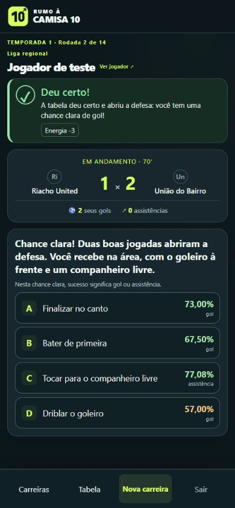

# Chances construídas — regras 0.10.1

Duas ações bem-sucedidas seguidas na construção da jogada geram uma chance clara imediata, antes de avançar o relógio. Contam passes, dribles, desarmes e movimentações das situações com bola; conversas, apoio emocional, reclamações e tentativas de simulação não constroem essa sequência. Falhas e gols/assistências pessoais encerram a sequência. A oportunidade também é cancelada se o personagem sair de campo.

O jogador recebe quatro alternativas: finalizar no canto, bater de primeira, servir um companheiro livre ou driblar o goleiro. Nesta situação, um sucesso produz diretamente um gol pessoal ou uma assistência. Uma falha desperdiça a oportunidade. A oportunidade é consumida uma vez e o relógio retoma o fluxo normal. Desde a versão 0.10.2, o sorteio adicional de conversão também foi removido de todas as finalizações comuns: sucesso no chute é gol.

Os percentuais dependem das habilidades, energia, confiança, ritmo e força adversária. A chance clara usa dificuldades menores para os chutes e bônus de 15–20 pontos percentuais, limitada a 90%. A interface identifica “gol” ou “assistência”. Nos chutes comuns, a interface também identifica chance de gol; nos passes e dribles comuns, identifica sucesso da ação, que pode continuar a jogada sem marcar. O resultado continua dependendo do sorteio exibido.

As mesmas regras funcionam nos três modos. Os modos rápido e expresso escolhem a alternativa conforme a estratégia, passando pelo mesmo motor. Com os cinco momentos regulares em campo, podem ocorrer até duas oportunidades extras construídas por partida. A sequência ocupa apenas um contador e um sinalizador no estado da partida e é removida ao consumir a oportunidade ou finalizar o jogo. Novas partidas começam sem sequência; o carregamento aceita partidas antigas sem esses campos. Não há migração de banco nem necessidade de nova carreira.

“Pedir a tabela” agora relata que você tocou, recebeu a devolução e ganhou espaço. Os sucessos de passes, chutes, dribles e desarmes também têm descrições ligadas à ação.

## Verificação local

- `tests/match-momentum.php`: 2.425 verificações, incluindo sequência imediata, quatro alternativas, percentuais, gols, assistências, falhas, desgaste, minuto 80 e consumo único.
- `tests/match-momentum.php --mysql`: persistência da oportunidade, resultado, reload, replay idempotente e proteção contra tela desatualizada, com conta descartável removida. Executado antes de acrescentar as duas verificações adicionais de desgaste e nova partida.
- `tests/run.php`: 27.979 verificações em 30 temporadas completas e seis posições; destaques pessoais correspondem às estatísticas.
- `tests/play-modes.php`: 523 verificações dos três modos, incluindo temporadas oficiais. A contagem antiga máxima de oito decisões foi atualizada para incluir as oportunidades extras construídas.
- `tests/http.php http://rumo10.local`: 79 verificações no IIS.
- `tests/presentation.php` e `tests/scene-failures.php`: apresentação e 1.153 verificações das respostas de falha passaram.
- PHP lint e `git diff --check`: passaram.

Os testes do catálogo piloto usaram `RUMOHUB_ENABLED=0` somente nos processos CLI. Os três modos e o HTTP foram verificados com a configuração local atual. Não houve alteração das carreiras humanas. Apache e produção não foram acessados.

Prévia de leitura com jogador fictício em 390 × 844: quatro escolhas visíveis e sem transbordamento horizontal. Os valores da captura são exemplos calculados para esse jogador.

## Como testar

Continue sua carreira em [rumo10.local](http://rumo10.local/carreira), no modo normal. Busque dois sucessos consecutivos em ações de construção com bola. A segunda ação abre imediatamente a decisão “Chance clara!”. Escolha uma alternativa: em caso de sucesso, confira o gol ou assistência no destaque e no placar. A oportunidade não reconstitui retroativamente sequências de decisões feitas antes desta atualização.
