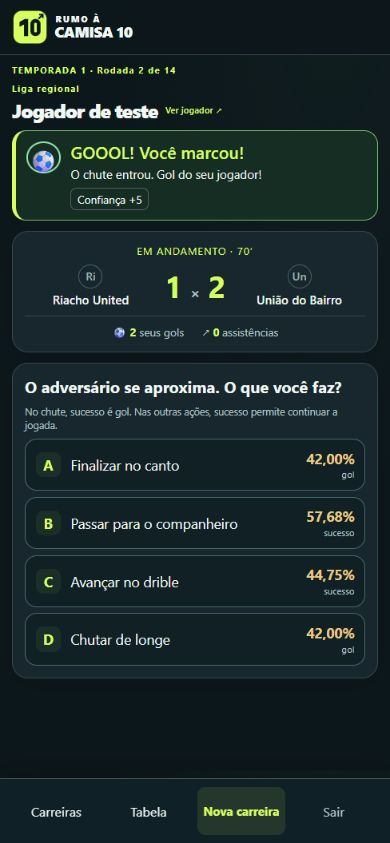

# Finalização e gol — regras 0.10.2

Sucesso em qualquer chute durante a partida agora significa gol do personagem. Foi removido o segundo sorteio, que antes convertia somente 60% dos chutes bem-sucedidos em gols. Por exemplo, uma finalização com chance de 40% antes tinha chance efetiva de gol de 24%; agora tem 40%.

Cada tentativa registra uma finalização. Sucesso registra um gol pessoal, atualiza o placar e mostra o destaque de gol. Falha não registra gol pessoal. A interface mostra “Chance de gol” nos chutes comuns e nas chances claras. Habilidades, energia, confiança, ritmo e força do adversário continuam determinando a probabilidade. Passes e dribles comuns continuam sendo ações de construção; o treino de finalização não gera gols de partida.

O texto de sucesso das finalizações do catálogo agora diz que o chute venceu o goleiro. Resultados anteriores já salvos não são reescritos. A mudança funciona nos três modos e nas carreiras existentes; não exige migração de banco.

Verificação local:

- `tests/finishing.php`: 6.721 verificações nas 28 alternativas de chute comuns/legadas, cobrindo sucesso, falha, estatísticas, chance sorteada, placar e destaque. Foram sorteadas 1.120 tentativas; todo sucesso foi gol.
- `tests/match-momentum.php`: 2.425 verificações das chances construídas.
- `tests/run.php`: 27.979 verificações em 30 temporadas completas e seis posições, com destaques pessoais coerentes.
- `tests/presentation.php`: rótulos de chance de gol e apresentação passaram.
- `tests/play-modes.php`: 529 verificações dos três modos e temporadas oficiais passaram.
- `tests/http.php http://rumo10.local`: 79 verificações no IIS passaram, com conta descartável removida.
- PHP lint e `git diff --check`: passaram.

Prévia mobile em 390 × 844, com jogador fictício e quatro alternativas visíveis:

Apache e produção não foram acessados nesta alteração. Para testar, continue em [rumo10.local/carreira](http://rumo10.local/carreira) e escolha uma finalização: quando o sorteio der sucesso, confira o gol do personagem e o placar.
