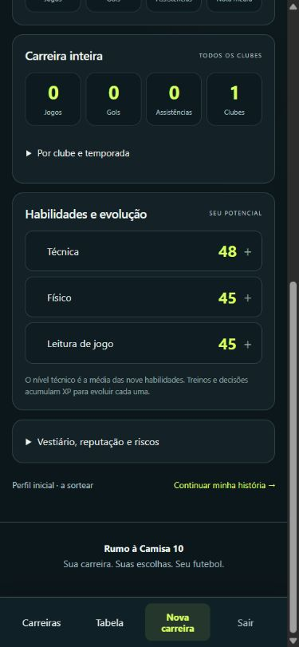

# Consequências, XP e interface — regras 0.10.4

Revisão editorial dos enunciados e alternativas das 214 situações (856 escolhas), incluindo os casos legados e de reserva. Foram adicionados ajustes individuais para 178 alternativas em 94 situações, além de regras por categoria e etapa em `SceneConsequences`. As quatro escolhas de chance clara continuam usando o mesmo processamento de campo.

## Correções de contexto

| Escolha/situação | Comportamento revisado |
|---|---|
| Mensagens, promessas e entrevistas | Foco, confiança, relações ou reputação; sem risco de lesão ou desgaste de treino por publicar uma mensagem. |
| Evento até tarde | Custo de energia e possível benefício de lazer; sem risco de lesão inventado. |
| Consultar o clube sobre entrevista/rumor | Foco e relação com a diretoria; não ganha confiança do treinador por falar com a comunicação. |
| Planejar um bloco físico | Organiza a preparação; não concede XP de resistência como se o treino já tivesse sido executado. |
| Treino de cabeceio e domínio | XP relacionado à finalização ou controle da bola, usando as habilidades disponíveis no jogo. |
| Aquecimento | Prática técnica de menor intensidade e menor custo que uma sessão completa de treino. |
| Descansar, ouvir música ou preservar privacidade | Não reduz entrosamento ou confiança no futebol sem justificativa. Uma recuperação frustrada não gera punição automática de confiança. |
| Culpar colegas/reclamar agressivamente | O desgaste de relações ocorre pela própria conduta, inclusive se a tentativa fracassar. Não ganha confiança por humilhar um companheiro. |
| Sucesso excepcional | Pode melhorar benefícios; não aumenta custos ou punições intrínsecas da escolha. |
| Erro de chute/passe/drible | Não gera falta ou cartão automaticamente. Um desarme grave atrasado pode gerar falta e cartão, descritos na narração. |
| Discussão com arbitragem/provocação | Pode gerar cartão nas escolhas que realmente envolvem confronto; o texto relata quando isso acontece. |
| Tentar cavar uma falta | Sucesso ganha uma cobrança, sem gol automático; a tentativa frustrada pode ser punida como simulação. |
| Gol e assistência | Melhoram a confiança; passe, chute, drible e desarme bem executados também concedem XP da habilidade praticada. Recuperar e depois passar/driblar registra o desarme. |

O custo de energia em campo inclui a atividade do personagem durante o segmento da partida. A recuperação automática da folga continua sendo uma rotina separada dos efeitos específicos da escolha. O jogo usa abstrações: não é uma simulação médica ou psicológica, e o equilíbrio deverá continuar sendo acompanhado em partidas jogadas.

Os efeitos exibidos respeitam a variação real após limites de 0–100, inclusive quando mais de uma penalidade atinge o mesmo atributo. Benefícios e XP dependem de sucesso; custos intrínsecos e exposição a riscos não desaparecem porque o sorteio falhou. As consequências de falha são definidas pelo contexto, em vez de descontar confiança indiscriminadamente.

## XP e interface

No modo normal, o XP efetivamente calculado pela curva de evolução é multiplicado por dois. Rápido e expresso mantêm a taxa anterior; custos e perdas não são multiplicados. Exemplos para um personagem jovem: prática em campo que concedia 2 XP passa a conceder 4; treino que concedia 4 passa a conceder 8. Limites internos de habilidade e o ciclo do personagem continuam preservados.

“Ciclo da carreira” foi removido da ficha. Mensagens de confirmação/erro também não antecipam as idades internas de auge ou encerramento. O usuário continua vendo a idade atual do personagem e a opção de encerrar a carreira quando disponível. Os avisos sobre encerramento definitivo e preservação/exclusão de dados foram mantidos.

Não há migração de banco ou necessidade de nova carreira. A revisão vale para as próximas decisões; dados e resultados antigos não são reescritos. Recarregue a página antes de continuar em [rumo10.local](http://rumo10.local/carreira).

## Verificações locais

- `tests/scene-consequences.php`: 177.795 verificações das 856 alternativas em sucesso, excepcional, falha e falha grave, incluindo atributos válidos, limites, feedback real, ausência de benefícios na falha e casos de disciplina.
- `tests/normal-xp.php`: 369 verificações de XP em dobro, progressão e ausência de informações internas na interface.
- `tests/scene-failures.php`: 1.153 verificações; os testes de consulta foram atualizados para os efeitos contextuais revisados.
- `tests/social-context.php`: relações pessoais e efeitos do elenco preservados.
- `tests/scenes-strength.php`: 2.955 verificações de situações, mecânicas e probabilidades.
- `tests/finishing.php`: 6.721 verificações de chutes, mantendo sucesso como gol.
- `tests/match-momentum.php`: 2.425 verificações de chances construídas; opção `--mysql` também passou em persistência, replay e proteção de versão.
- `tests/run.php`: 27.979 verificações em 30 temporadas e seis posições.
- `tests/lifecycle.php`: 144 verificações das regras internas de evolução e encerramento.
- `tests/play-modes.php`: 529 verificações dos três modos e temporadas oficiais.
- `tests/scenes-mysql.php`: 20 verificações de persistência de situações e overall.
- `tests/retirement-storage.php`: 28 verificações do histórico compacto e encerramento.
- `tests/presentation.php`: apresentação e percentuais passaram.
- `tests/http.php http://rumo10.local`: 79 verificações no IIS, com conta descartável removida.

Os testes do catálogo piloto usaram `RUMOHUB_ENABLED=0` apenas nos processos CLI; modos e HTTP usaram a configuração local atual. Carreiras humanas e tabelas de outros projetos foram preservadas. PHP lint e `git diff --check` passaram. Apache e produção não foram acessados.

Revisão da ficha em 390 × 844, com personagem fictício:

