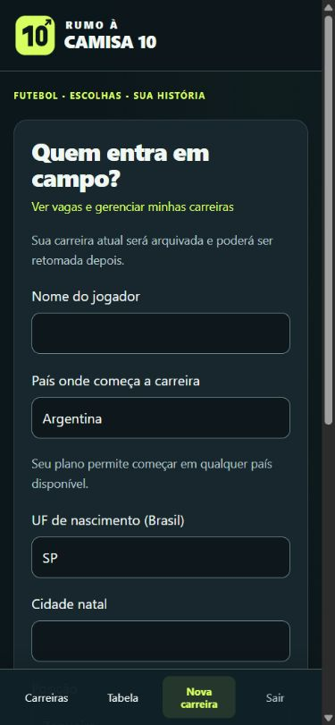

# País de estreia por plano — regras 0.10.5

Novas carreiras do plano gratuito começam no **Brasil**. O plano pago permite escolher qualquer país disponível para uma estreia jogável no catálogo atual: **83 países/mercados de futebol** na instalação local com RumoHub. O formulário mostra apenas Brasil para contas gratuitas e a lista completa para contas pagas. O plano é lido de `rumo10_conta_planos`, não de campos enviados pelo navegador.

A seleção representa o país do **primeiro clube**, separado da cidade natal. Nesta etapa, o personagem continua tendo UF e cidade natal brasileiras, validadas pelo cadastro de municípios existente. Não foi criado um cadastro internacional de cidades/nacionalidades.

## Fluxo

1. Criar jogador e escolher o país de estreia permitido pelo plano.
2. Girar a roleta do perfil inicial, sem clube previamente selecionado.
3. Receber até três ofertas e escolher o primeiro clube.
4. Iniciar o calendário desse clube.

No Brasil, permanecem as regras estaduais: A4/A3 em São Paulo conforme o perfil e a divisão de entrada cadastrada nas outras UFs, com distância aproximada entre municípios. No exterior, usamos a divisão mais baixa disponível para clubes daquele país. As ofertas são ordenadas por uma semente salva na carreira, sem recalcular o sorteio ao recarregar. Não há promessa de proximidade com a cidade natal brasileira: não foram inventadas distâncias ou coordenadas internacionais.

Países cujos clubes disputam uma liga de outro mercado continuam disponíveis: o filtro considera o país do clube e sua participação num campeonato jogável, não apenas o país nominal da competição. Se houver menos de três clubes elegíveis na divisão de entrada, aparecem somente os existentes. Reservas são excluídas das propostas iniciais.

## Proteções e preservação

- O controlador valida o país com o plano real da conta.
- O repositório confere novamente o plano dentro da transação antes de criar ou arquivar a carreira atual.
- Enviar `plan=pago` ou um país estrangeiro num POST de conta gratuita não concede acesso; o pedido retorna 422 e preserva a carreira anterior.
- Países fora do catálogo de entrada são rejeitados também no plano pago.
- A restrição vale para criação; propostas internacionais, transferências, carreiras existentes e sua retomada não são bloqueadas. Uma mudança de plano não expulsa o personagem do clube em que já joga.
- Permanecem as cotas existentes: três carreiras no gratuito e dez no pago. Esta atualização não implementa cobrança ou altera o plano de contas humanas.

Dados novos (`starting_country` e `entry_seed`) ficam no snapshot JSON existente. Carreiras anteriores usam Brasil como padrão de estreia quando não têm o campo. Não há migração de banco, reimportação de clubes ou necessidade de nova carreira para continuar jogando. O banco permanece `rumohub`.

## Verificações locais

- `tests/entry-countries.php` com Hub atual: **1.321 verificações** dos 83 países, planos, roleta, propostas, país dos clubes, divisão de entrada, semente e calendário iniciado após a escolha.
- `tests/entry-countries.php --mysql`: validação do plano real, rejeição antes de arquivar, persistência/replay, campeonato inglês e continuidade após mudança de plano passaram. Executado antes de acrescentar a verificação adicional de calendário para cada um dos países.
- Catálogo piloto isolado com `RUMOHUB_ENABLED=0`: 1.103 verificações de 74 países passaram antes da inclusão da verificação adicional de calendário por país. Essa configuração foi aplicada somente ao processo CLI.
- `tests/http.php http://rumo10.local`: **91 verificações** no IIS, incluindo gratuito somente Brasil, POST forjado, pago Inglaterra, país inválido, roleta, ofertas, escolha do clube, preservação após mudança de plano e os fluxos anteriores.
- `tests/onboarding.php`: **88 verificações** brasileiras de início, proximidade, escudos e alternativas inválidas passaram.
- `tests/career-slots.php`: **22 verificações** de vagas, propriedade e exclusão passaram.
- `tests/unified-database.php`: **66 verificações** de banco e integridade passaram.
- `tests/presentation.php`, lint dos 11 arquivos PHP alterados/adicionados e `git diff --check`: passaram.

Contas de teste foram removidas; contas, planos e carreiras humanas foram preservados. Apache e produção não foram acessados.

Revisão em 390 × 844, sem transbordamento horizontal: prévia paga com Argentina selecionada. A prévia isolada usa o catálogo piloto; o teste HTTP usa os 83 países do Hub atual.

## Acesso

Abra [Nova carreira](http://rumo10.local/carreira/nova). O campo “País onde começa a carreira” apresenta as opções do plano cadastrado na conta. A roleta e a escolha dos clubes continuam nas telas seguintes.
